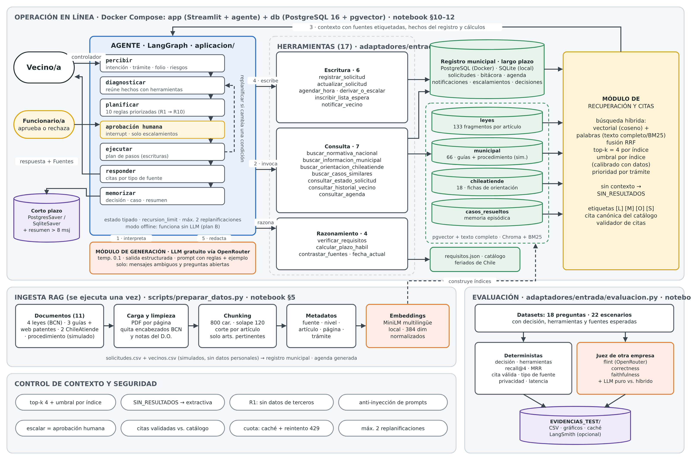
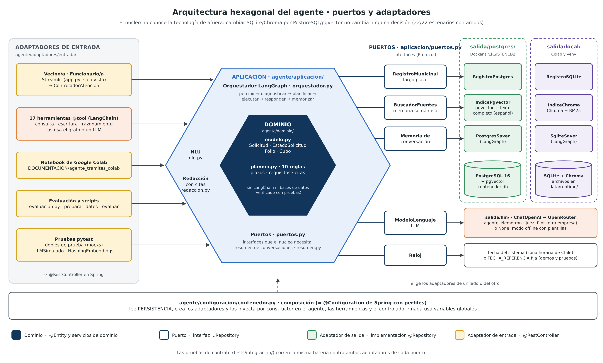
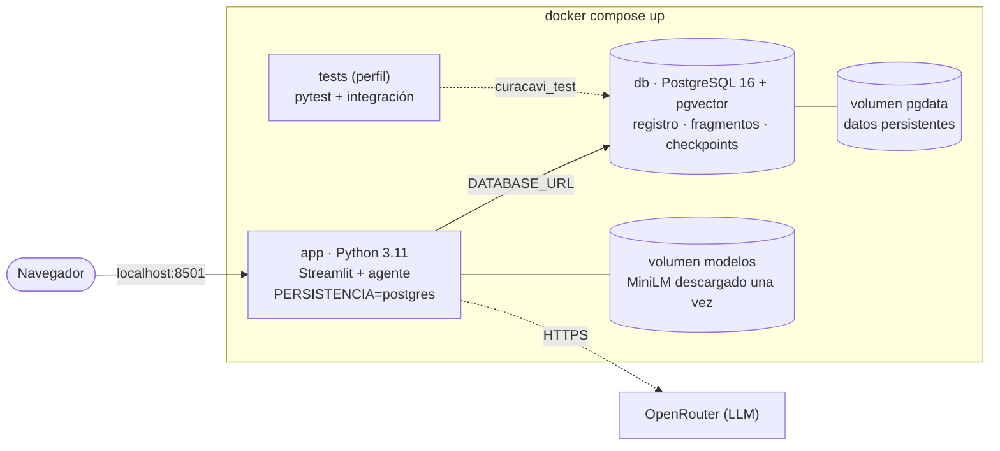
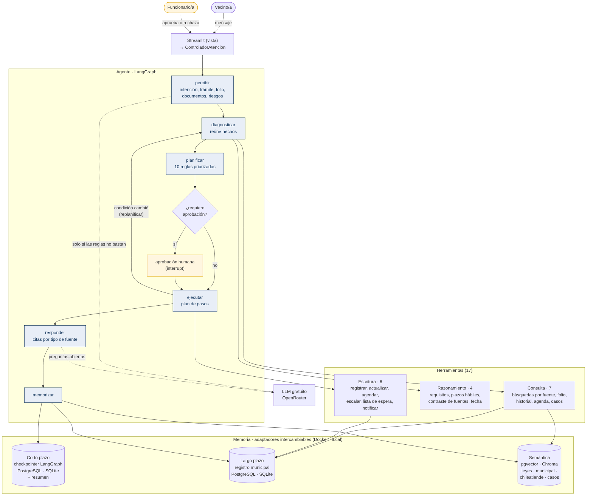
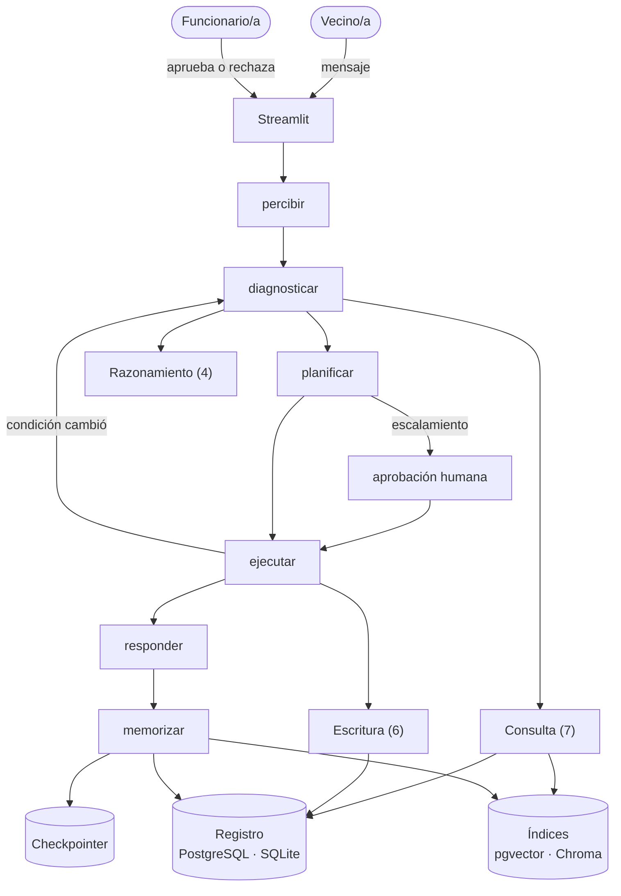
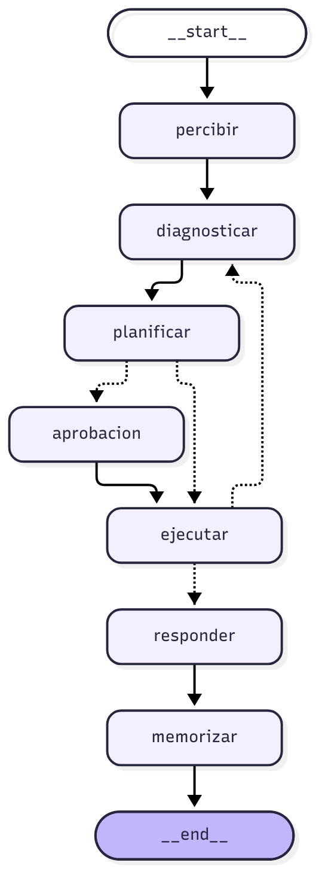
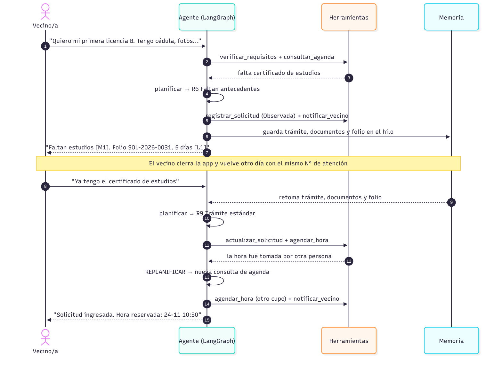
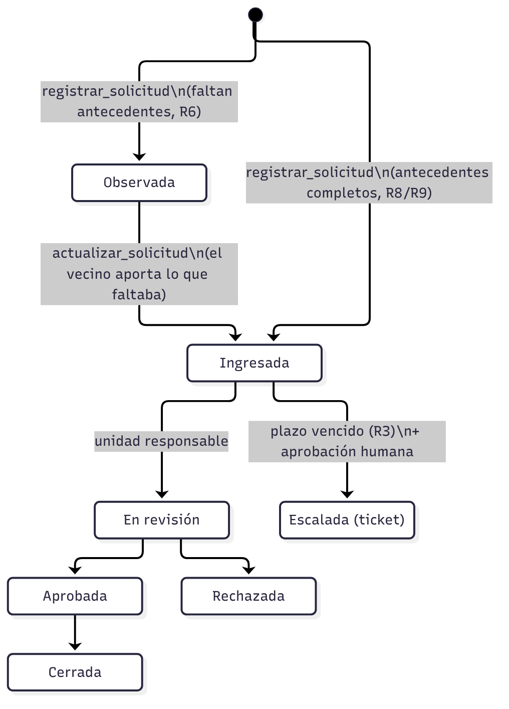

# Arquitectura y orquestación

## Vista completa



Cómo leerla:
- **Operación en línea:** el vecino escribe y el agente recorre sus nodos.
  1. Interpreta el mensaje (con el LLM solo si las reglas no bastan).
  2. Invoca las herramientas de consulta.
  3. Recibe el contexto con fuentes etiquetadas desde el módulo de recuperación.
  4. Ejecuta las escrituras en el registro municipal.
  5. Redacta la respuesta con sus fuentes.
- **Ingesta RAG:** se ejecuta una vez. Recorre documentos → carga y limpieza → chunks por artículo →
  metadatos → embeddings, y construye los índices (pgvector en Docker, Chroma en modo local).
- **Control:** los mecanismos que acotan el contexto y protegen la privacidad.
- **Evaluación:** datasets, métricas deterministas, juez y evidencias.

Fuente editable: `DOCUMENTACION/diagramas/arquitectura_completa.svg`.

## Arquitectura hexagonal (puertos y adaptadores)



Todo el código está en `APP_AGENTE_CURACAVI/agente/` (las rutas de esta sección son relativas a esa carpeta).
Se ordena de adentro hacia afuera y las dependencias siempre apuntan hacia el centro:

```
agente/
├── dominio/           modelo.py · planner.py · plazos.py · requisitos.py · citas.py · texto.py
├── aplicacion/        puertos.py · orquestador.py · nlu.py · redaccion.py · resumen.py · llm_utilidades.py
├── adaptadores/
│   ├── entrada/       controlador.py · herramientas/ (consulta, escritura, razonamiento) · evaluacion.py
│   └── salida/
│       ├── postgres/  registro.py · indice.py (pgvector) · conexion.py           → Docker
│       ├── local/     registro_sqlite.py · indice_chroma.py                       → Colab y venv
│       ├── llm/       cliente.py (OpenRouter: agente y juez de otra empresa; Gemini opcional)
│       └── memoria/   registro_sql.py (SQL común) · conversaciones.py · ingesta.py · busqueda_hibrida.py
└── configuracion/     settings.py · contenedor.py
```

| Capa | Carpeta | Qué contiene | Equivalente en Spring |
|---|---|---|---|
| Dominio | `dominio/` | `Solicitud` y `EstadoSolicitud` (entidad y transiciones), folio y cupo, las 10 reglas del planner, plazos hábiles, requisitos y citas | `@Entity`, objetos de valor y servicios de dominio |
| Aplicación | `aplicacion/` | Orquestador LangGraph, percepción del mensaje, redacción con citas y resumen; coordina el dominio a través de los puertos | `@Service` |
| Puertos | `aplicacion/puertos.py` | `RegistroMunicipal`, `BuscadorFuentes`, `ModeloLenguaje`, `Reloj` (interfaces `Protocol`) | interfaces `...Repository` |
| Adaptadores de entrada | `adaptadores/entrada/` (+ `app.py` y `scripts/`) | Controlador de la interfaz, las 17 `@tool`, el arnés de evaluación | `@RestController` |
| Adaptadores de salida | `adaptadores/salida/postgres/` (Docker) · `adaptadores/salida/local/` (Colab y venv) · `adaptadores/salida/llm/` | PostgreSQL + pgvector · SQLite + Chroma · OpenRouter (agente y juez; Gemini opcional) | implementaciones `@Repository` |
| Configuración | `configuracion/` | `settings.py` (parámetros) y `contenedor.py` (lee `PERSISTENCIA`, crea los adaptadores y los inyecta por constructor) | `application.properties` + `@Configuration` |

Cómo se verifica:
- `tests/test_arquitectura.py` revisa que el dominio no importe LangChain, bases de datos ni otras capas; que la
  aplicación no importe ningún adaptador; y que un adaptador se pueda reemplazar por otro sin tocar las herramientas.
- `tests/integracion/` corre la **misma** batería de pruebas contra SQLite/Chroma y contra PostgreSQL/pgvector, y
  los 22 escenarios completos sobre PostgreSQL. Las decisiones del agente son idénticas con ambos.

Fuente editable: `DOCUMENTACION/diagramas/arquitectura_hexagonal.svg` (`python -m scripts.diagrama_hexagonal`).

## Despliegue con Docker



Al arrancar, el contenedor `app` ejecuta `python -m scripts.preparar_datos --si-falta`: crea las tablas y los
índices solo si no existen, así los datos de la demo se conservan entre reinicios. Las tablas las crean los
adaptadores (una sola fuente del esquema); `APP_AGENTE_CURACAVI/db/init/` solo activa pgvector y crea la base de pruebas.
El `Dockerfile` está en `APP_AGENTE_CURACAVI/` y se construye desde la raíz del repositorio, que tiene el `docker-compose.yml`.

## Componentes



<details><summary>Fuente Mermaid (GitHub la dibuja)</summary>


</details>

## Grafo del agente (LangGraph)

Generado desde el código con `crear_agente(contenedor).grafo.get_graph().draw_mermaid()`
(`DOCUMENTACION/diagramas/grafo_langgraph.mmd`). Las líneas punteadas son decisiones condicionales.



| Nodo | Qué hace | Herramientas |
|---|---|---|
| `percibir` | Entiende el mensaje con reglas (y con el LLM solo si no basta) y lo combina con la memoria del hilo | — |
| `diagnosticar` | Reúne los hechos: historial, estado del folio, plazo, requisitos, agenda y casos similares | consulta, razonamiento |
| `planificar` | Aplica las 10 reglas priorizadas y arma el plan | — |
| `aprobacion` | Pausa (`interrupt`) hasta la respuesta del funcionario | — |
| `ejecutar` | Ejecuta el plan; si una condición cambió, vuelve a `diagnosticar` | escritura |
| `responder` | Redacta con citas por tipo de fuente y las valida | — |
| `memorizar` | Guarda la decisión, indexa el caso resuelto, actualiza el hilo y resume si la conversación es larga | — |

## Ejemplo de flujo completo (continuidad y replanificación)



## Ciclo de vida de una solicitud



## Memoria

| Tipo | Implementación | Qué guarda | Para qué |
|---|---|---|---|
| Corto plazo | `PostgresSaver` (Docker) o `SqliteSaver` (local) de LangGraph por `thread_id` + resumen | mensajes, trámite en curso, documentos declarados, folio, plan | retomar el trámite aunque se cierre la app; los mensajes antiguos se resumen (sobre 8) |
| Largo plazo | PostgreSQL (`agente/adaptadores/salida/postgres/registro.py`) o SQLite (`agente/adaptadores/salida/local/registro_sqlite.py`) | solicitudes, bitácora, agenda, notificaciones, escalamientos, lista de espera, decisiones | historial del vecino entre sesiones y trazabilidad para el funcionario |
| Semántica | pgvector + texto completo (`agente/adaptadores/salida/postgres/indice.py`) o Chroma + BM25 (`agente/adaptadores/salida/local/indice_chroma.py`) | leyes por artículo, guías, fichas, casos resueltos | recuperar contexto por significado y por palabras exactas, con umbral por índice |

## Por qué un diseño híbrido

- Las **reglas de negocio** (qué hacer y en qué orden) están en código. Son deterministas, se pueden probar y
  no dependen de un modelo gratuito que puede fallar o quedarse sin cuota.
- El **LLM** se usa donde aporta: entender mensajes ambiguos, redactar respuestas a preguntas abiertas y
  resumir conversaciones largas. Si falla, el agente sigue funcionando con plantillas (modo offline).
- La evaluación compara este diseño con un agente "LLM puro" (`create_agent` con las 17 herramientas) en
  los mismos escenarios.
