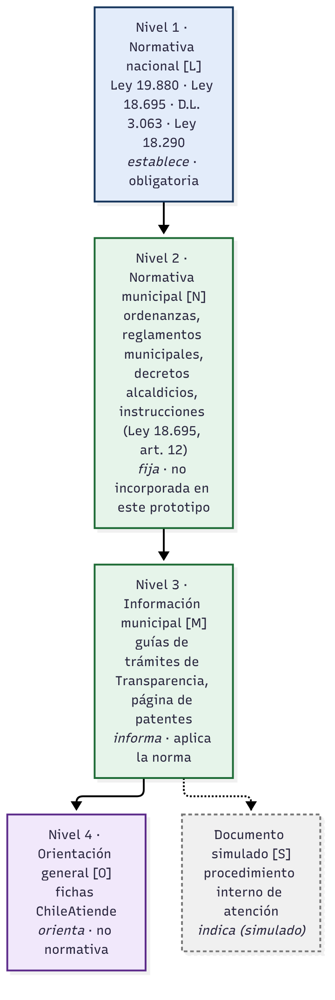

# Marco normativo y tratamiento de las fuentes

Una ley nacional, una norma municipal, una guía de trámites y una ficha de ChileAtiende **no valen lo mismo
ni se citan igual**. El agente clasifica cada fuente, la cita según su tipo y usa el verbo que corresponde.

| Nivel | Tipo | Fuentes del proyecto | Naturaleza | Verbo | Etiqueta |
|---|---|---|---|---|---|
| 1 | Ley o norma con rango de ley | Ley N° 19.880; Ley N° 18.695 (texto refundido: DFL N° 1/2006, Interior); D.L. N° 3.063 (texto refundido: D.S. N° 2.385/1996, Interior); Ley N° 18.290 (texto refundido: DFL N° 1/2007, Transportes) | Obligatoria | establece | `[L]` |
| 2 | Norma municipal (Ley N° 18.695, art. 12) | No incorporada en este prototipo | Ordenanza: general y obligatoria para la comunidad. Reglamento municipal: orden interno. Decreto alcaldicio: casos particulares. Instrucción: directivas a funcionarios | fija | `[N]` |
| 3 | Información municipal | Guías de trámites (Transparencia Activa) y página de patentes | Informativa: aplica la norma, no crea obligaciones | informa | `[M]` |
| 4 | Orientación general | Fichas ChileAtiende | Informativa nacional, no normativa | orienta | `[O]` |
| — | Documento simulado | Procedimiento interno de atención | Política interna simulada para el caso académico | indica (simulado) | `[S]` |

## Términos que no son equivalentes

| Término | Distinción |
|---|---|
| Plazo legal / plazo interno | El legal lo fija una ley (Ley N° 19.880, arts. 24, 27 y 31). El interno es una política de atención (aquí, simulada: OIRS 10 días hábiles). |
| Días hábiles | La Ley N° 19.880, art. 25, excluye sábados, domingos y festivos. Si una guía municipal no dice si sus días son hábiles, el agente lo advierte. |
| Impuesto / derecho / contribución | El permiso de circulación es un **impuesto** (D.L. N° 3.063, art. 12). Los **derechos municipales** se pagan por servicios o permisos (art. 40) y, si la ley no fija la tasa, los fija una **ordenanza** local (art. 42). La patente es una **contribución** (art. 23). |
| Requisito legal / antecedente municipal | Ejemplo: acreditar el pago del permiso anterior (D.L. N° 3.063, art. 16) frente al certificado de gases, que pide la guía municipal. |
| Ley / texto refundido | Se cita el cuerpo con su título oficial: "DFL N° 1/2006 (Interior), texto refundido de la Ley N° 18.695". |

## Cómo se implementa

1. **Catálogo único** (`data/catalogo_fuentes.json`): nivel, título oficial, cita corta, emisor, versión, URL y
   artículos pertinentes de cada fuente. El LLM nunca escribe títulos de normas.
2. **Índices separados por nivel**: `leyes`, `municipal` y `chileatiende`.
3. **Leyes por artículo**: solo se indexan los artículos pertinentes al caso. Cada fragmento lleva su número
   de artículo.
4. **Citas por etiqueta**: el LLM cita `[L1]`, `[M2]` u `[O1]` y el código las convierte en la cita exacta.
   `validar_citas()` elimina las etiquetas inexistentes y detecta leyes mencionadas que no se recuperaron. Si la
   respuesta no pasa la validación, se reintenta una vez y luego se usa la versión extractiva (sin LLM).
5. **Respuesta por secciones**: Normativa nacional · Información municipal · Orientación general · Diferencias
   entre fuentes.
6. **`contrastar_fuentes`**: compara fechas y plazos entre niveles. Ejemplo: el período del permiso de
   circulación. El D.L. N° 3.063, art. 15, dice "hasta el 31 de marzo"; la guía municipal, "durante el mes de
   marzo"; ChileAtiende, "del 1 de febrero al 31 de marzo". La ley prevalece y se recomienda confirmar en la
   Dirección de Tránsito.
7. **Versiones**: dos textos descargados de la BCN son versiones intermedias (D.S. N° 2.385, vigente hasta el
   18-04-2024; DFL N° 1/2007, vigente hasta el 04-04-2025). Cada vez que se citan, el agente lo advierte y
   remite a la versión vigente.

## Limitación declarada

No se incorporó la Ordenanza de Derechos Municipales vigente de Curacaví. Por eso el nivel 2 no tiene
documentos en el índice, y el nivel municipal se compone de guías informativas y del procedimiento simulado.
