# Agente de Trámites Municipales — Agente IA con memoria, planificación y RAG

Proyecto de la Evaluación Parcial N°2 de **ISY0101 Ingeniería de Soluciones con IA** (Duoc UC).

Agente de IA que atiende a los vecinos de la **Municipalidad de Curacaví** en sus trámites: revisa sus documentos,
ingresa la solicitud, agenda la hora, escala los casos con plazo vencido (con aprobación de un funcionario) y
explica qué dice la ley y qué dice la municipalidad, citando cada fuente según su tipo. Recuerda cada caso hasta
terminarlo, aunque el vecino vuelva otro día.

- **Levantarlo con Docker:** `docker compose up --build` → http://localhost:8501 ([cómo ejecutarlo](#ejecución))
- **Notebook de Google Colab:** [`DOCUMENTACION/agente_tramites_colab.ipynb`](DOCUMENTACION/agente_tramites_colab.ipynb) —
  [abrir en Colab](https://colab.research.google.com/github/Thoorcito/Agente_IA_Municipalidad_Curacavi/blob/main/DOCUMENTACION/agente_tramites_colab.ipynb)
- **Informe:** [`DOCUMENTACION/Informe_EP2_ISY0101.docx`](DOCUMENTACION/Informe_EP2_ISY0101.docx) · **Presentación:** [`DOCUMENTACION/Presentacion_EP2_ISY0101.pptx`](DOCUMENTACION/Presentacion_EP2_ISY0101.pptx)

**Integrantes:** Gonzalo Díaz · Jesús Martínez · Felipe Bravo — Docente: Cristian Araya Salazar

> Prototipo académico. Los datos de solicitudes y vecinos son simulados; no es un canal oficial de la Municipalidad.

## La historia

**El problema.** En Curacaví, renovar el permiso de circulación, sacar la licencia de conducir o pedir una patente
exige reunir documentos descritos en guías municipales, fichas de ChileAtiende y leyes extensas, que no siempre
dicen lo mismo. La atención es presencial y el vecino suele volver varias veces: le faltó un documento, no había
horas o su reclamo quedó sin respuesta. El funcionario revisa a mano requisitos y plazos de cada caso.

**La solución.** Un agente que no solo responde, sino que **gestiona el trámite completo**:

1. **Entiende** lo que pide el vecino: trámite, folio, documentos que tiene y los que le faltan.
2. **Revisa** los requisitos y separa lo que exige la ley de lo que pide la municipalidad.
3. **Actúa** en el sistema municipal: registra el folio, agenda la hora o inscribe en lista de espera, y notifica.
4. **Se adapta**: si otra persona toma la hora mientras agenda, replanifica y reserva otra.
5. **Pide aprobación** a un funcionario antes de escalar un caso con plazo vencido.
6. **Recuerda**: si el vecino vuelve con el documento que faltaba, retoma el mismo folio; reconoce rechazos anteriores.
7. **Cita bien**: la ley *establece*, la guía municipal *informa*, ChileAtiende *orienta*. Nunca inventa una ley.

## Componentes

Las rutas de código son relativas a `APP_AGENTE_CURACAVI/`.

| Componente | Tecnología | Dónde |
|---|---|---|
| Orquestación del agente | LangGraph (`StateGraph`) sobre LangChain 1.x: 7 nodos, replanificación y pausa para aprobación humana | `agente/aplicacion/orquestador.py` · notebook §9 |
| Herramientas (17) | `@tool` de LangChain: consulta 7 · escritura 6 · razonamiento 4 | `agente/adaptadores/entrada/herramientas/` · §7 |
| Planificación | 10 reglas priorizadas, deterministas y probadas (servicio de dominio) | `agente/dominio/planner.py` · §8 |
| LLM | OpenRouter, modelo gratuito: solo para mensajes ambiguos, preguntas abiertas y resúmenes | `agente/adaptadores/salida/llm/cliente.py` · §4 |
| Embeddings | `paraphrase-multilingual-MiniLM-L12-v2` local, 384 dimensiones | `agente/adaptadores/salida/memoria/ingesta.py` · §5 |
| Memoria semántica (RAG) | **pgvector** en PostgreSQL (Docker) · Chroma (local y Colab); búsqueda híbrida con umbral por índice | `agente/adaptadores/salida/` · §5–6 |
| Memoria de largo plazo | **PostgreSQL** (Docker) · SQLite (local): solicitudes, bitácora, agenda, decisiones | `agente/adaptadores/salida/` · §11 |
| Memoria de corto plazo | Checkpointer de LangGraph por hilo (PostgreSQL o SQLite) + resumen de conversación | `agente/adaptadores/salida/memoria/conversaciones.py` · §11 |
| Arquitectura | **Hexagonal**: dominio puro, puertos e inyección de dependencias | `agente/dominio/`, `agente/aplicacion/puertos.py`, `agente/configuracion/contenedor.py` |
| Despliegue | **Docker Compose**: agente + PostgreSQL 16 con pgvector | `docker-compose.yml` (raíz), `Dockerfile` |
| Interfaz | Streamlit (vista) + controlador | `app.py`, `agente/adaptadores/entrada/controlador.py` |
| Evaluación | 22 escenarios, 18 preguntas con referencia, recuperación antes/después, juez de otra empresa | `agente/adaptadores/entrada/evaluacion.py` · §13–14 |
| Pruebas | pytest con mocks y patrón AAA; cobertura mínima 80 % | `tests/` |

## Arquitectura

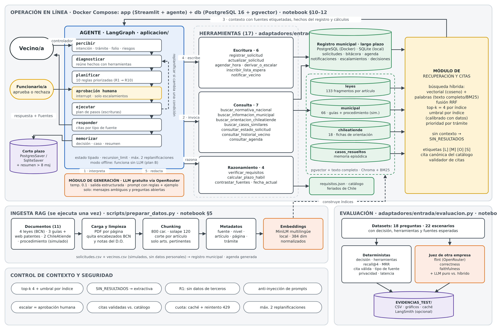

*Vista completa: el flujo numerado 1 → 5 sigue una solicitud; abajo, la ingesta RAG, los controles y la
evaluación. Fuente editable: `DOCUMENTACION/diagramas/arquitectura_completa.svg`.*

### Arquitectura hexagonal (puertos y adaptadores)

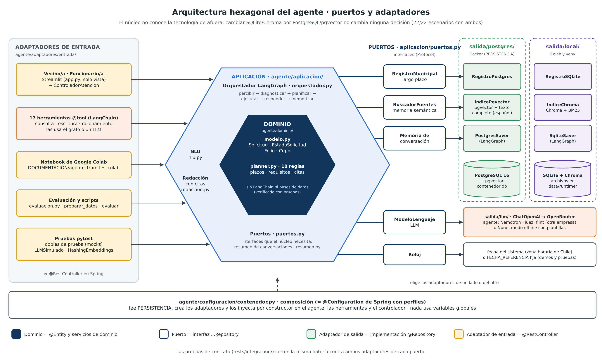

El núcleo del agente no conoce la tecnología de afuera. Las dependencias siempre apuntan hacia el centro:

| Capa | Qué contiene | Equivalente en Spring |
|---|---|---|
| **Dominio** (`agente/dominio/`) | Entidad `Solicitud` y sus estados, folio, cupo, las 10 reglas, plazos hábiles, requisitos y citas. Sin LangChain ni bases de datos | `@Entity` y servicios de dominio |
| **Aplicación** (`agente/aplicacion/`) | Orquestador LangGraph, percepción del mensaje, redacción con citas y resumen. No importa ningún adaptador | `@Service` |
| **Puertos** (`agente/aplicacion/puertos.py`) | Interfaces: `RegistroMunicipal`, `BuscadorFuentes`, `ModeloLenguaje`, `Reloj` | interfaces `Repository` |
| **Adaptadores de entrada** (`agente/adaptadores/entrada/`) | `ControladorAtencion` (lo usa la vista Streamlit), las 17 `@tool`, el arnés de evaluación | `@RestController` |
| **Adaptadores de salida** (`agente/adaptadores/salida/`) | `postgres/`: `RegistroPostgres`, `IndicePgvector`, `PostgresSaver` · `local/`: `RegistroSQLite`, `IndiceChroma`, `SqliteSaver` · `llm/`: OpenRouter (agente Nemotron y juez flint; Gemini opcional) | implementaciones `@Repository` |
| **Configuración** (`agente/configuracion/`) | `settings.py` (parámetros) y `contenedor.py`, que lee `PERSISTENCIA` y conecta todo por constructor | `application.properties` + `@Configuration` |

Gracias a esto, el mismo agente corre con **PostgreSQL + pgvector en Docker** y con **SQLite + Chroma en Colab**
(Colab no ejecuta Docker): los 22 escenarios dan exactamente las mismas decisiones con ambos.

- Orquestación, grafo, memoria y despliegue: [DOCUMENTACION/arquitectura.md](DOCUMENTACION/arquitectura.md)
- Reglas de decisión: [DOCUMENTACION/reglas.md](DOCUMENTACION/reglas.md) · Herramientas: [DOCUMENTACION/herramientas.md](DOCUMENTACION/herramientas.md)
- Ley, norma municipal, información y orientación: [DOCUMENTACION/marco_normativo.md](DOCUMENTACION/marco_normativo.md)
- Por qué cada componente: [DOCUMENTACION/decisiones.md](DOCUMENTACION/decisiones.md) · Alcance: [DOCUMENTACION/alcance.md](DOCUMENTACION/alcance.md)
- **Glosario de conceptos aplicados** (RAG, agentes, memoria, hexagonal, Docker...): [DOCUMENTACION/conceptos.md](DOCUMENTACION/conceptos.md)


## Estructura

```
├── README.md                     Este documento
├── docker-compose.yml            docker compose up --build (agente + PostgreSQL/pgvector)
├── .env.example · .gitignore · .dockerignore
│
├── APP_AGENTE_CURACAVI/          TODO el código del agente
│   ├── Dockerfile · requirements.txt · pyproject.toml
│   ├── app.py                    Arranque de la interfaz Streamlit (vista)
│   ├── agente/                   Paquete Python con arquitectura hexagonal
│   │   ├── dominio/              modelo (Solicitud, estados, folio, cupo) · planner (10 reglas) · plazos · requisitos · citas
│   │   ├── aplicacion/           puertos (interfaces) · orquestador (LangGraph) · nlu · redaccion · resumen
│   │   ├── adaptadores/
│   │   │   ├── entrada/          controlador · herramientas/ (17 @tool) · evaluacion
│   │   │   └── salida/
│   │   │       ├── postgres/     registro · indice pgvector · conexion            (Docker)
│   │   │       ├── local/        registro SQLite · indice Chroma                  (Colab y venv)
│   │   │       ├── llm/          OpenRouter: agente y juez de otra empresa
│   │   │       └── memoria/      SQL común · checkpointer · ingesta RAG · búsqueda híbrida
│   │   └── configuracion/        settings · contenedor (inyección de dependencias)
│   ├── data/                     Leyes, guías, ChileAtiende, catálogo, requisitos, CSV simulados, eval/
│   ├── db/init/                  Activa pgvector y crea la base de pruebas (Docker)
│   ├── scripts/                  preparar_datos · evaluar · ficha_tecnica · capturas · diagramas
│   └── tests/                    Pruebas unitarias (AAA, mocks) + integracion/ (SQLite vs. PostgreSQL)
│
├── DOCUMENTACION/
│   ├── Informe_EP2_ISY0101.docx · Presentacion_EP2_ISY0101.pptx
│   ├── agente_tramites_colab.ipynb          Notebook de Google Colab
│   ├── arquitectura · reglas · herramientas · decisiones · conceptos · marco_normativo · alcance (.md)
│   └── diagramas/                Fuentes editables (.svg, .mmd)
│
└── EVIDENCIAS_TEST/              Todo lo que muestra este README
    ├── capturas/                 Pantallas de la aplicación
    ├── diagramas/                Arquitectura completa, hexagonal, grafo, secuencia, estados (PNG)
    ├── pruebas/                  Salida de pytest, imagen de las pruebas y de la cobertura
    └── evaluaciones/             Resultados de escenarios, recuperación y juez (CSV y gráficos)
```

## Ejecución

Las claves son gratuitas: [OpenRouter](https://openrouter.ai/keys) para el agente y
[Google AI Studio](https://aistudio.google.com/apikey) para el evaluador. Se escriben en un archivo `.env`
(copia de `.env.example`), que **nunca** se sube al repositorio. Sin claves, el agente funciona en modo offline.

### Opción A · Docker (recomendada)

Requisito: [Docker Desktop](https://www.docker.com/products/docker-desktop/).

```bash
git clone https://github.com/Thoorcito/Agente_IA_Municipalidad_Curacavi.git
cd Agente_IA_Municipalidad_Curacavi
cp .env.example .env                # Windows: copy .env.example .env   → pegue sus claves
docker compose up --build           # la primera vez tarda (descarga imágenes y el modelo MiniLM, ~470 MB)
```

Abra http://localhost:8501. La barra lateral indica **Persistencia: PostgreSQL + pgvector (Docker)**.

| Comando | Para qué |
|---|---|
| `docker compose run --rm tests` | Todas las pruebas, incluidas las de PostgreSQL + pgvector |
| `docker compose exec app python -m scripts.preparar_datos` | Deja los datos de la demo en su estado inicial |
| `docker compose exec app python -m scripts.evaluar escenarios --offline` | Evalúa los 22 escenarios |
| `docker compose down` | Detiene todo (los datos quedan guardados) |
| `docker compose down -v` | Detiene y borra la base y el modelo descargado |

La base queda disponible en `localhost:5433` (usuario y clave `curacavi`) para revisarla con DBeaver o pgAdmin.

### Opción B · Python local (plan B, sin Docker)

Requisito: Python 3.10 a 3.12. Usa SQLite + Chroma (`PERSISTENCIA=local`). El `.env` va en la raíz del repo.

```bash
cp .env.example .env                # Windows: copy .env.example .env   → pegue sus claves
cd APP_AGENTE_CURACAVI
python -m venv .venv
source .venv/bin/activate           # Windows: .venv\Scripts\activate
pip install -r requirements.txt
python -m scripts.preparar_datos    # crea la base y los índices (la primera vez descarga MiniLM)
streamlit run app.py
```

### Opción C · Google Colab

[Abrir el notebook](https://colab.research.google.com/github/Thoorcito/Agente_IA_Municipalidad_Curacavi/blob/main/DOCUMENTACION/agente_tramites_colab.ipynb)
y seguir las celdas marcadas con ✏️. Usa el adaptador local, porque Colab no ejecuta Docker.

**Opciones útiles en `.env`:** `LLM_PROVIDER=offline` (sin LLM, plan B de la demo) · `FECHA_REFERENCIA=2026-11-04`
(fija la fecha para que los plazos de la demo no cambien) · `LANGSMITH_TRACING=true` y `LANGSMITH_API_KEY` (traza
de cada nodo y herramienta en LangSmith, sin cambiar el código).

## Recorrido del notebook

| Sección | Contenido |
|---|---|
| 1 | Caso organizacional, problema y objetivos medibles |
| 2–4 | Instalación, claves, modelos y arquitectura en uso |
| 5 | Datos, catálogo de fuentes y anatomía de un fragmento (chunk, embedding, búsqueda híbrida) |
| 6 | Recuperación: antes/después y calibración del umbral por índice |
| 7 | Herramientas de consulta, escritura y razonamiento |
| 8–9 | Planificador con reglas priorizadas, grafo LangGraph y arquitectura hexagonal |
| 10 | Escenarios con traza (incluye condiciones cambiantes y replanificación) |
| 11 | Memoria: continuidad entre sesiones y resumen |
| 12 | Humano en el ciclo (aprobación del funcionario) |
| 13–14 | Evaluación: escenarios, LLM puro vs. híbrido, respuestas con juez |
| 15–16 | Verificación final |

## Datos

| Tipo | Fuentes | Uso |
|---|---|---|
| Normativa nacional | Ley 19.880, Ley 18.695, D.L. 3.063, Ley 18.290 (BCN), cortadas por artículo | índice `leyes` (133 fragmentos) |
| Información municipal | Guías de Transparencia de Curacaví (permiso, licencias, patentes), página de patentes y procedimiento interno (**simulado**) | índice `municipal` (66) |
| Orientación nacional | Fichas de ChileAtiende (permiso de circulación y licencias) | índice `chileatiende` (18) |
| Registro municipal | `data/solicitudes.csv` (30 folios) y `data/vecinos.csv`, **simulados** y sin datos personales | registro de largo plazo + casos resueltos |
| Requisitos | `data/requisitos.json`: 5 trámites, cada requisito con su fundamento legal, municipal u orientativo | herramienta `verificar_requisitos` |
| Evaluación | `data/eval/escenarios.json` (22) y `data/eval/preguntas.json` (18, con respuesta de referencia) | `agente/adaptadores/entrada/evaluacion.py` |

### Trazabilidad: etiquetas de cita

Cada afirmación de una respuesta lleva una etiqueta: la **letra** indica el tipo de fuente (y cuánto pesa) y el
**número**, el orden dentro de esa respuesta. Al final de cada respuesta, el bloque **Fuentes** dice a qué documento,
artículo y versión corresponde cada etiqueta.

| Etiqueta | Nivel | Tipo de fuente | Fuentes del proyecto | Naturaleza | El agente dice |
|---|---|---|---|---|---|
| `[L]` | 1 | Normativa nacional | Ley 19.880, Ley 18.695, D.L. 3.063, Ley 18.290 | Obligatoria (rango legal) | la ley *establece* |
| `[N]` | 2 | Normativa municipal | No incorporada en este prototipo (ordenanzas, decretos alcaldicios) | Obligatoria en la comuna | el municipio *fija* |
| `[M]` | 3 | Información municipal | Guías de trámites de Curacaví y página de patentes | Informativa: aplica la norma, no crea obligaciones | la municipalidad *informa* |
| `[O]` | 4 | Orientación general | Fichas de ChileAtiende | Informativa nacional, no normativa | ChileAtiende *orienta* |
| `[S]` | — | Documento simulado | Procedimiento interno de atención (inventado para el caso) | Solo académico | *indica (simulado)* |

Si dos fuentes difieren, prevalece la de menor número de nivel (la ley) y el agente lo advierte. Las etiquetas **no
las escribe el LLM**: el código etiqueta los fragmentos recuperados antes de entregárselos, y el validador rechaza
cualquier etiqueta o ley que no esté entre ellos. Niveles y verbos: `data/catalogo_fuentes.json`; asignación y
validación: `agente/dominio/citas.py`; detalle normativo: [`DOCUMENTACION/marco_normativo.md`](DOCUMENTACION/marco_normativo.md).

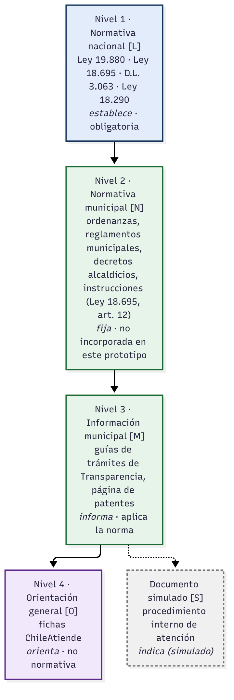

## Parámetros

<!-- FICHA:INICIO -->
| Componente | Valor |
|---|---|
| LLM del agente | nvidia/nemotron-3.5-super-vl:free (OpenRouter, nivel gratuito) |
| Evaluador (juez) | recursive/flint-v1.0:free (OpenRouter, otra empresa que el agente) |
| Embeddings | sentence-transformers/paraphrase-multilingual-MiniLM-L12-v2 (local, 384 dimensiones) |
| Arquitectura | Hexagonal: dominio, puertos y adaptadores intercambiables |
| Persistencia (Docker) | PostgreSQL 16 + pgvector: registro, vectores y memoria de conversaciones |
| Persistencia (local y Colab) | SQLite + Chroma |
| Colecciones del RAG | municipal, leyes, chileatiende, casos_resueltos |
| Recuperación | Híbrida vectorial + palabras (RRF k=60), top-k 4, umbral por índice |
| Fragmentación | 800 caracteres, solape 120, corte por artículo |
| Framework | LangGraph + LangChain 1.x |
| Memoria corto plazo | Checkpointer de LangGraph (PostgreSQL o SQLite) + resumen de conversación |
| Memoria largo plazo | Registro municipal: solicitudes, bitácora, agenda, notificaciones, decisiones |
| Temperatura | 0.1 |
<!-- FICHA:FIN -->

*Generada desde `agente/configuracion/settings.py` con `python -m scripts.ficha_tecnica --readme`. Una prueba verifica que coincida.*

## Pruebas

```bash
docker compose run --rm tests           # desde la raíz: todas, incluidas las de PostgreSQL + pgvector
cd APP_AGENTE_CURACAVI && pytest        # sin Docker: unitarias + contrato con SQLite; cobertura mínima 80 %
```

- **Patrón AAA:** cada prueba separa *Arrange* (preparar), *Act* (ejecutar) y *Assert* (verificar).
- **Mocks:** ninguna prueba usa internet ni claves. El LLM y el juez se reemplazan por `LLMSimulado`; los embeddings
  por `HashingEmbeddings` (determinista); la fecha queda fija en 2026-11-04 (`tests/conftest.py`).
- **Arquitectura:** `tests/test_arquitectura.py` verifica que el dominio no importe frameworks, bases de datos ni otras
  capas; que la aplicación no importe adaptadores; que los adaptadores cumplan los puertos y que un adaptador se pueda
  reemplazar por un doble de prueba.
- **Contrato:** `tests/integracion/` corre la misma batería contra SQLite/Chroma y contra PostgreSQL/pgvector, más
  los 22 escenarios sobre PostgreSQL y una prueba de concurrencia (8 atenciones piden la misma hora: solo una la obtiene).
- **Qué se prueba:** cada herramienta y regla, la prioridad entre reglas, las entidades del dominio, la continuidad
  entre sesiones, el resumen, la búsqueda híbrida, la memoria episódica, la validación de citas (incluso si el LLM
  inventa una ley), la pausa para aprobación humana, la replanificación, el controlador y la coherencia documental.

**Resultado:** con PostgreSQL + pgvector, **192 pruebas aprobadas y 98 % de cobertura**. Sin PostgreSQL (`pytest` en
el computador, sin Docker): 181 aprobadas, 11 omitidas (las de PostgreSQL) y 94 % de cobertura. Salida completa en
`EVIDENCIAS_TEST/pruebas/pytest_salida.txt`.

| Ejecución de las pruebas (con PostgreSQL + pgvector) | Reporte de cobertura |
|---|---|
| 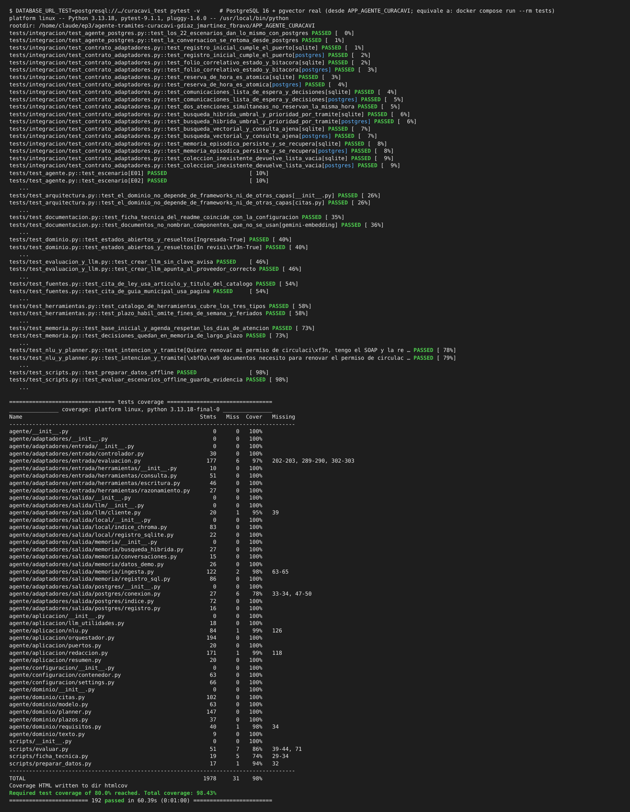 | 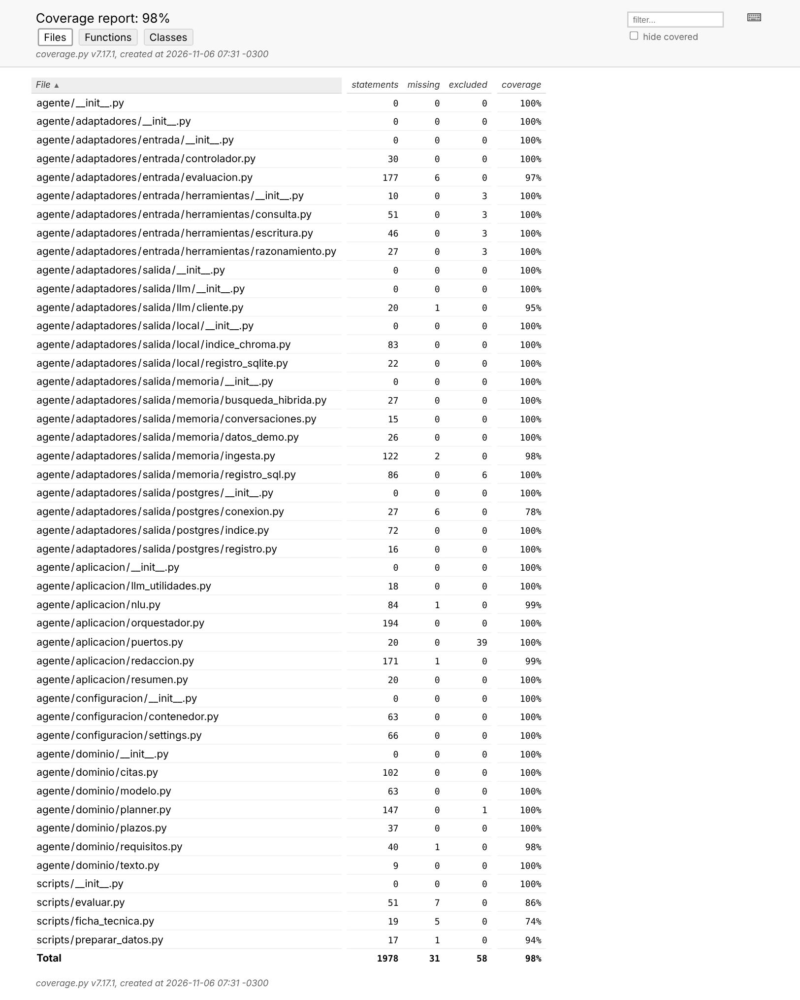 |

## Evaluación y resultados

Desde `APP_AGENTE_CURACAVI/` (o con `docker compose exec app ...`):

```bash
python -m scripts.evaluar escenarios --offline        # decisiones (sin LLM)
python -m scripts.evaluar recuperacion --calibrar     # antes/después de la recuperación + umbrales por índice
python -m scripts.evaluar respuestas --juez           # correctness y faithfulness (requiere claves)
```

| Evaluación | Qué mide | Resultado |
|---|---|---|
| Escenarios (n = 22) | Regla, acción, herramientas, escrituras y replanificación esperadas | **22/22** sin LLM con SQLite + Chroma y con PostgreSQL + pgvector (`escenarios_offline.csv`); **22/22** con el LLM en Colab (`escenarios_llm.csv`) |
| Recuperación (14 preguntas + 4 ajenas, MiniLM) | Recall@4, hit, MRR y rechazo de preguntas ajenas: diseño base vs. cada mejora | Recall@4 **0,75 → 0,93** · hit **0,93 → 1,00** · MRR **0,58 → 0,85** · rechazo de preguntas ajenas **1,00** en todas las versiones (`recuperacion_resumen_local.csv`) |
| Respuestas (n = 18, redactadas por el LLM) | Cita válida, tipo de fuente, privacidad, correctness y faithfulness (juez) | Herramienta correcta **1,00** (18) · cita válida **1,00** (18) · tipo de fuente correcto **1,00** (14) · privacidad **1,00** (2) · correctness **0,66** y faithfulness **0,67** (n = 12; 6 juicios no interpretables) · latencia media **9,4 s** (`respuestas_llm.csv`, `resumen_respuestas.csv`) |
| LLM puro vs. híbrido (n = 3: E01–E03) | Herramientas correctas y escrituras en los mismos escenarios | Herramientas correctas: híbrido **1,00** vs. LLM puro **0,67** · escrituras correctas: **1,00** vs. **0,00** (el LLM puro no registró ningún trámite) · escrituras indebidas: 0 vs. 0 · latencia: **0,19 s** vs. **9,2 s** (`llm_puro.csv`). n = 3 porque se agotó la cuota diaria gratuita |

| Recuperación: diseño base vs. mejoras | Calidad de las respuestas (n en la tabla) |
|---|---|
| 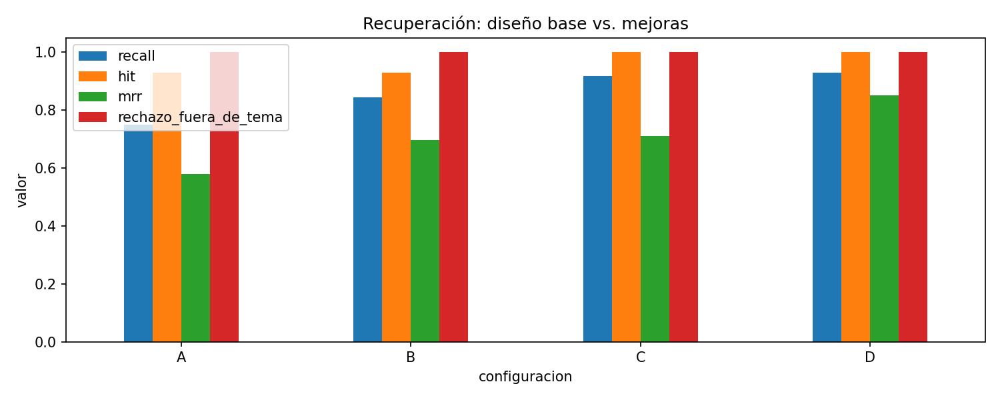 | 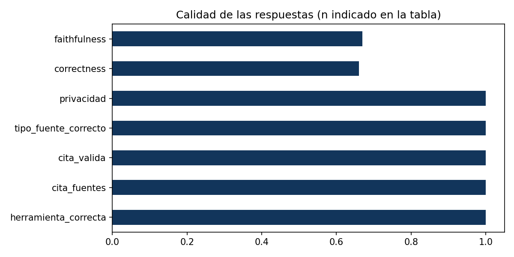 |

**Lectura de los resultados.** Las decisiones, herramientas, citas y privacidad no dependen del LLM y por eso son
exactas. La correctness del juez es moderada: el modelo gratuito resume y a veces omite parte de la respuesta de
referencia (los comentarios del juez están en `respuestas_llm.csv`); como las citas se validan por código, una
respuesta incompleta nunca cita una fuente inexistente. El juez es `recursive/flint-v1.0` (otra empresa que el agente),
también gratuito; 6 de sus 18 salidas no se pudieron interpretar (JSON cortado o vacío). El código ya lee los JSON
cortados y vuelve a pedir esos juicios en la siguiente ejecución.

## Evidencias de pruebas

| | |
|---|---|
| 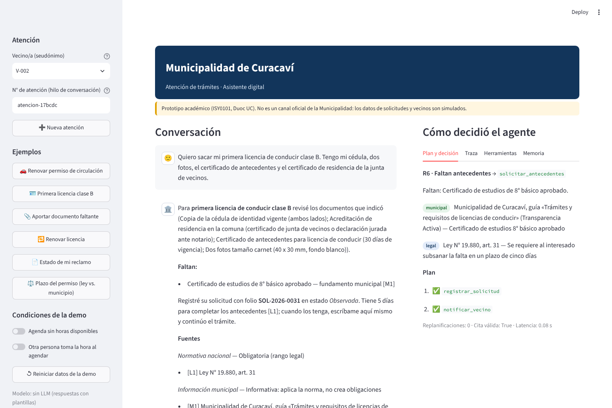 **Faltan antecedentes:** registra el folio como «Observada» y pide lo que falta, con su fundamento | 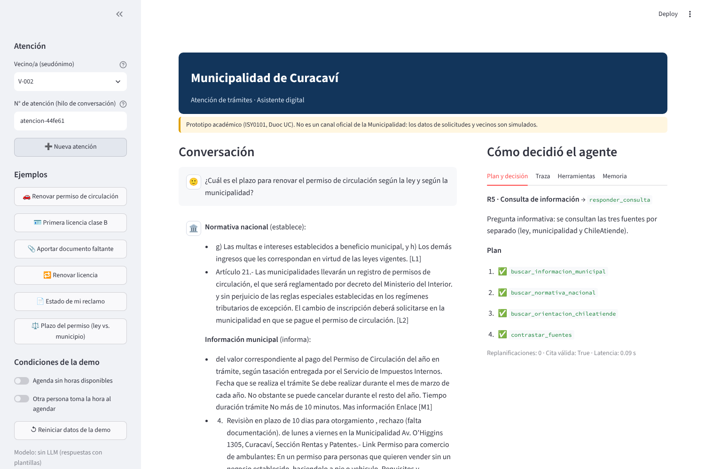 **Fuentes separadas por nivel:** ley, información municipal y orientación, con la diferencia entre ellas |
| 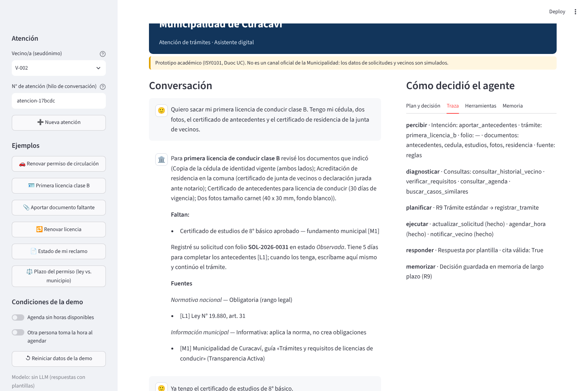 **Continuidad:** vuelve con el documento, el agente retoma el folio y agenda (traza de nodos) | 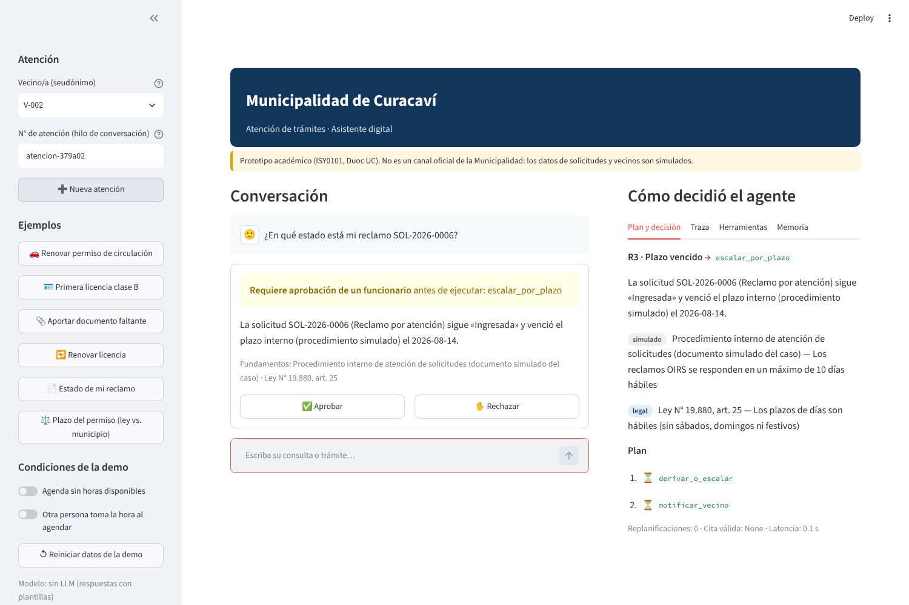 **Plazo vencido:** el grafo se pausa hasta que el funcionario aprueba o rechaza |

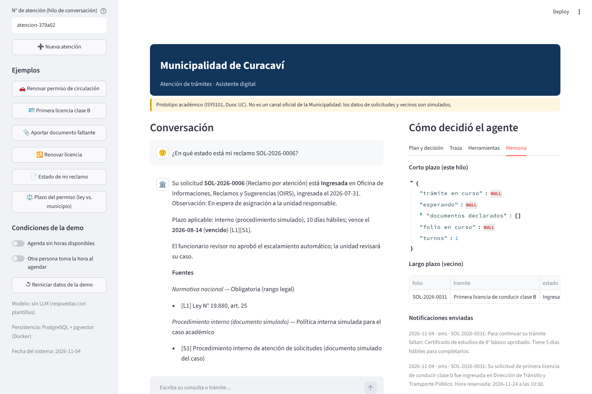

*Capturas tomadas con PostgreSQL + pgvector en modo offline (`python -m scripts.capturas`): reglas, herramientas y
memoria funcionan igual que en la ejecución real; solo la redacción de preguntas abiertas no usa el LLM.*

### Condiciones cambiantes (interruptores de la demo, Docker + PostgreSQL)

| Agenda sin horas disponibles → R7 | Otra persona toma la hora al agendar → replanificación |
|---|---|
| 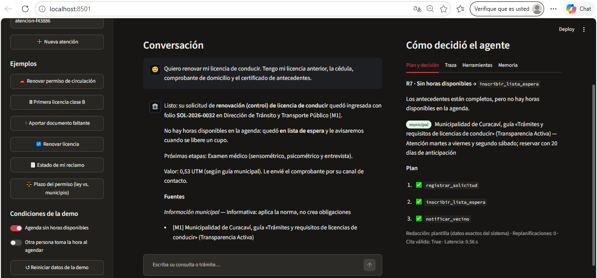 | 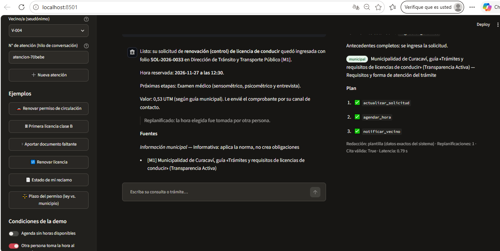 |
| Los documentos están completos pero la agenda no tiene cupos: el agente registra el folio, inscribe al vecino en **lista de espera** y lo notifica, sin inventar una hora. | La hora elegida se ocupa mientras el agente ejecuta: `agendar_hora` falla, el grafo vuelve a diagnosticar y **replanifica** (`Replanificaciones: 1`). Reutiliza el folio ya creado (`actualizar_solicitud`, sin duplicarlo) y reserva otra hora. |

### Sin LLM vs. con LLM (misma app, Docker + PostgreSQL)

Las mismas acciones con `LLM_PROVIDER=offline` (izquierda) y con el LLM de OpenRouter (derecha). Las **decisiones,
herramientas y datos son idénticos**: el LLM solo cambia la **redacción** de las preguntas abiertas. Los trámites
usan plantilla en ambos casos, a propósito, para que el folio, la hora y los montos salgan exactos.

| Caso | Sin LLM (respuesta extractiva) | Con LLM (`nvidia/nemotron-3.5-super-vl:free`) |
|---|---|---|
| Configuración | 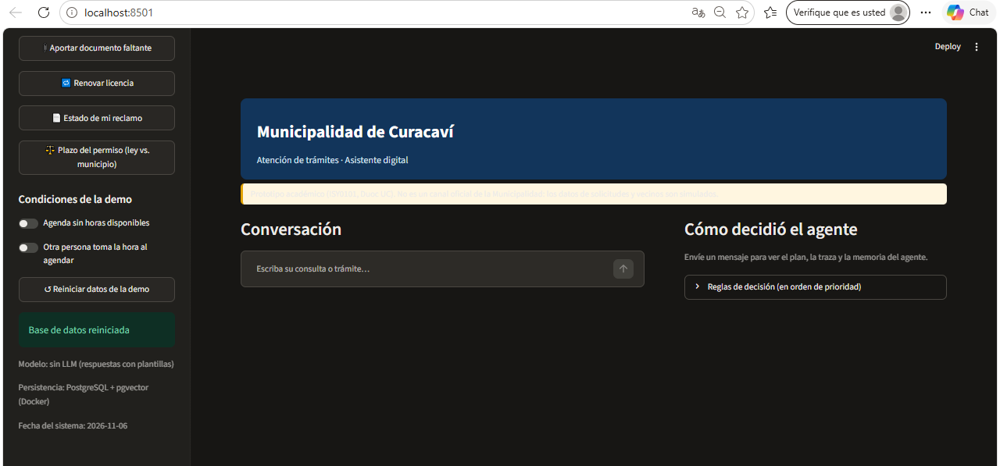 | 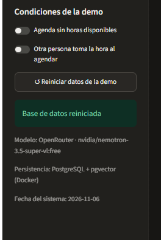 |
| Plazo del permiso (ley vs. municipio) · R5 | 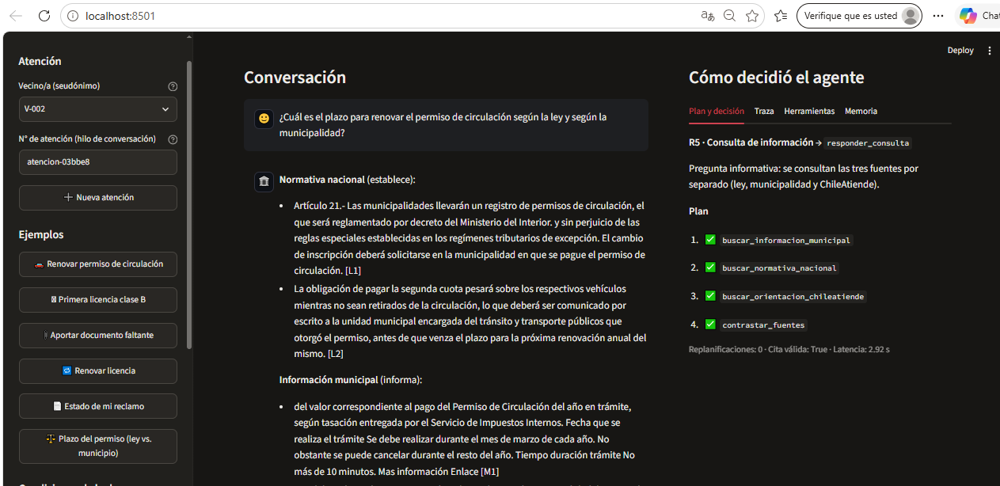 Fragmentos textuales por fuente · 2,9 s | 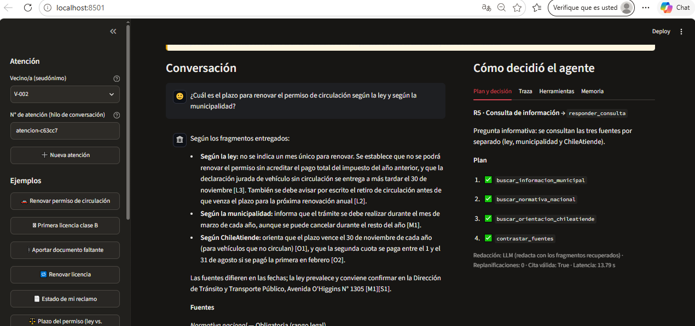 Responde la pregunta, separa ley, municipio y ChileAtiende y advierte que las fuentes difieren · 13,8 s |
| Herramientas del mismo turno | 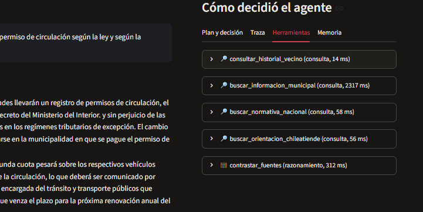 | 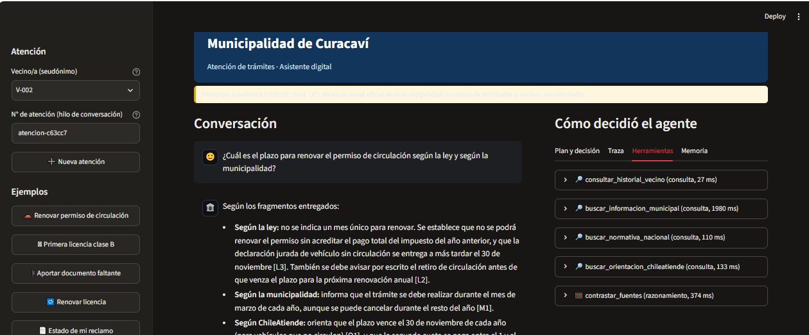 Mismas 5 herramientas |
| Pregunta libre: patente comercial | 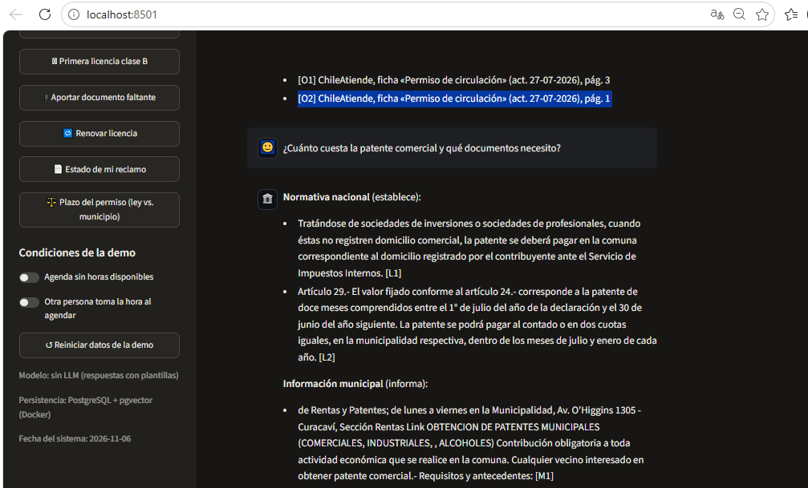 El primer fragmento legal no responde lo pedido | 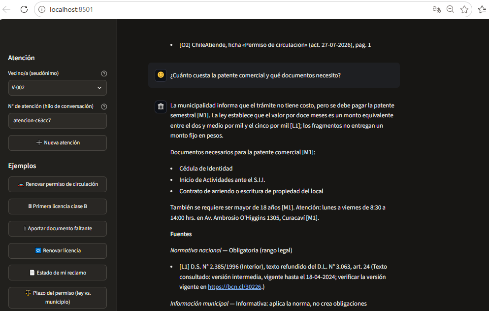 Costo y documentos, y aclara que los fragmentos no dan un monto fijo |
| Trámite: renovar permiso · R9 | 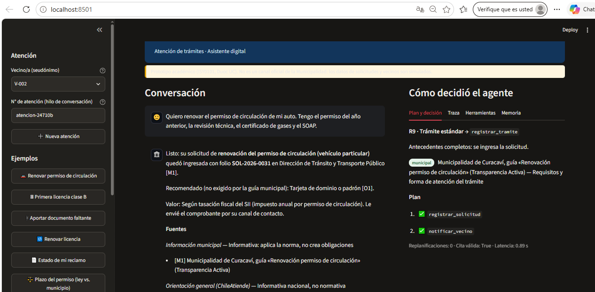 | 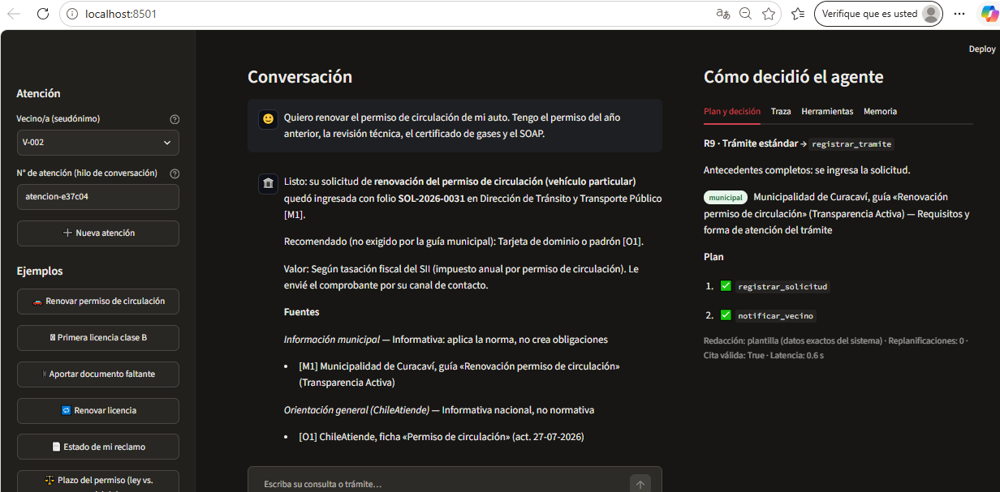 Igual: «Redacción: plantilla» |

En ambos modos las citas son válidas: las etiquetas las asigna el código y el validador rechaza cualquier etiqueta
o ley que no esté en los fragmentos. Si el LLM falla, el panel lo informa («Redacción: plantilla» + motivo).

## Problemas resueltos durante el desarrollo

| Problema | Solución aplicada |
|---|---|
| Las leyes completas generaban muchos más fragmentos que las guías y tapaban los resultados | Índices separados por tipo de fuente y leyes acotadas a los artículos pertinentes |
| Palabras exactas ("SOAP", "artículo 25") que la búsqueda vectorial no priorizaba | Búsqueda híbrida (vectorial + palabras) con fusión RRF |
| El LLM gratuito podía inventar títulos o números de ley | Etiquetas de cita, catálogo de fuentes y validador; si falla, respuesta extractiva |
| Cuota diaria de los modelos gratuitos | Decisiones por reglas (sin LLM), caché de evaluación y reintento ante 429 |
| Cambiar la base de datos obligaba a tocar herramientas y grafo | Arquitectura hexagonal: puertos + adaptadores + inyección por constructor |
| Diferencias de instalación entre computadores | Docker Compose con PostgreSQL + pgvector; el venv queda como plan B |
| En Windows, la carpeta temporal de Chroma quedaba bloqueada al terminar una prueba (`WinError 32`) | `TemporaryDirectory(ignore_cleanup_errors=True)` en la evaluación de recuperación |
| Dos atenciones podían reservar la misma hora | `UPDATE … WHERE estado = 'disponible'` atómico, probado con 8 hilos simultáneos en PostgreSQL |
| El LLM clasificó un saludo («hola, buenas tardes») como consulta de estado sin folio (escenario E22, 21/22) | Los saludos se reconocen por reglas, sin gastar una llamada, y el LLM no puede proponer una consulta de estado sin folio. Resultado: 22/22 con LLM |
| La cuota gratuita de OpenRouter (50 llamadas al día) se agotó en mitad de la evaluación y la caché guardó respuestas sin LLM como si fueran del LLM | La caché guarda el modo de redacción y descarta respuestas de respaldo; la evaluación se detiene al agotarse la cuota y continúa donde quedó |
| El juez gratuito a veces devolvía el JSON cortado o vacío | Lectura tolerante de los puntajes y nuevo intento de los juicios faltantes en la siguiente ejecución |
| El modelo gratuito inicial dejó de ser gratuito (404) y el reemplazo, un modelo que razona, gastaba todo el límite de tokens pensando: la respuesta llegaba vacía y el agente usaba el respaldo sin avisar | Modelo configurable solo por `.env` (`LLM_MODEL`), límite de 4000 tokens con razonamiento corto (`LLM_REASONING_EFFORT=low`) y aviso visible en el panel con el motivo cuando no se usa el LLM |

## Seguridad y privacidad

- Sin RUT, teléfonos ni domicilios: los vecinos se identifican con seudónimos (V-001) y ninguna tabla tiene esos datos.
- La regla R1 rechaza pedidos de datos de terceros e intentos de cambiar las instrucciones del agente.
- Los escalamientos requieren la aprobación de un funcionario (humano en el ciclo).
- Las claves viven en `.env` (excluido por `.gitignore` y `.dockerignore`); nunca se suben al repositorio.

## Limitaciones conocidas

- Datos de solicitudes, vecinos y agenda **simulados**. El procedimiento interno de atención también es simulado.
- No incluye la Ordenanza de Derechos Municipales de Curacaví: el nivel "normativa municipal" no tiene documentos.
- Dos textos legales descargados son versiones intermedias; el agente lo advierte al citarlos. La guía de patentes es de 2012.
- El reconocimiento por reglas cubre los 5 trámites del alcance; otros mensajes se aclaran o se derivan.
- Los modelos gratuitos tienen cuota diaria y cambian seguido; el modelo se cambia en `.env`.
- Docker Desktop en Windows requiere WSL2 y virtualización activada; si no está disponible, se usa la opción B.

## Equipo

| Integrante | Responsabilidad |
|---|---|
| Felipe Bravo | Código del agente, arquitectura hexagonal, Docker, notebook de Colab y evidencias |
| Jesús Martínez | Informe técnico y presentación |
| Gonzalo Díaz | Auditoría del código, informe técnico y presentación |

## Uso de herramientas de IA

| Herramienta | Uso | Validado por |
|---|---|---|
| Claude (Anthropic) | Apoyo en la escritura de código, pruebas, diagramas y redacción de la documentación técnica | Felipe Bravo (código y pruebas) y Gonzalo Díaz (auditoría del código) |
| nvidia/nemotron-3.5-super-vl (OpenRouter) | Motor de lenguaje del agente (entender mensajes y redactar respuestas abiertas) | Equipo |
| recursive/flint-v1.0 (OpenRouter) | Evaluador automático (juez) de las respuestas, de otra empresa que el agente | Equipo |

Las conclusiones, las justificaciones técnicas y las reflexiones individuales del informe fueron redactadas por el
equipo, sin IA.

## Referencias

- Biblioteca del Congreso Nacional de Chile. (2003). *Ley N° 19.880, que establece bases de los procedimientos administrativos que rigen los actos de los órganos de la Administración del Estado*. https://www.bcn.cl/leychile/navegar?i=210676
- Biblioteca del Congreso Nacional de Chile. (2006). *DFL N° 1, que fija el texto refundido, coordinado y sistematizado de la Ley N° 18.695, Orgánica Constitucional de Municipalidades*. https://www.bcn.cl/leychile/navegar?i=251693
- Biblioteca del Congreso Nacional de Chile. (1996). *Decreto N° 2.385, que fija el texto refundido y sistematizado del Decreto Ley N° 3.063, de 1979, sobre Rentas Municipales*. https://bcn.cl/30226
- Biblioteca del Congreso Nacional de Chile. (2009). *DFL N° 1, que fija el texto refundido, coordinado y sistematizado de la Ley de Tránsito*. https://bcn.cl/3f03u
- ChileAtiende. (2026). *Permiso de circulación* y *Licencias de conducir* [Fichas]. https://www.chileatiende.gob.cl
- Chroma. (2026). *Chroma documentation*. https://docs.trychroma.com
- Cockburn, A. (2005). *Hexagonal architecture*. https://alistair.cockburn.us/hexagonal-architecture/
- Cormack, G. V., Clarke, C. L. A., & Büttcher, S. (2009). Reciprocal rank fusion outperforms Condorcet and individual rank learning methods. En *Proceedings of the 32nd International ACM SIGIR Conference* (pp. 758–759). https://doi.org/10.1145/1571941.1572114
- Docker. (2026). *Docker Compose documentation*. https://docs.docker.com/compose/
- Evans, E. (2003). *Domain-driven design: Tackling complexity in the heart of software*. Addison-Wesley.
- LangChain. (2026). *LangChain and LangGraph documentation*. https://docs.langchain.com
- Lewis, P., Perez, E., Piktus, A., Petroni, F., Karpukhin, V., Goyal, N., ... Kiela, D. (2020). Retrieval-augmented generation for knowledge-intensive NLP tasks. *Advances in Neural Information Processing Systems, 33*, 9459–9474.
- Malkov, Y. A., & Yashunin, D. A. (2020). Efficient and robust approximate nearest neighbor search using hierarchical navigable small world graphs. *IEEE Transactions on Pattern Analysis and Machine Intelligence, 42*(4), 824–836. https://doi.org/10.1109/TPAMI.2018.2889473
- Municipalidad de Curacaví. (s.f.). *Trámites y requisitos municipales* [Transparencia Activa]. https://transparencia.municipalidadcuracavi.cl
- pgvector. (2026). *pgvector: Open-source vector similarity search for Postgres*. https://github.com/pgvector/pgvector
- PostgreSQL Global Development Group. (2026). *PostgreSQL 16 documentation: Full text search*. https://www.postgresql.org/docs/16/textsearch.html
- Reimers, N., & Gurevych, I. (2019). Sentence-BERT: Sentence embeddings using Siamese BERT-networks. En *Proceedings of EMNLP-IJCNLP 2019* (pp. 3982–3992). https://arxiv.org/abs/1908.10084
- Robertson, S., & Zaragoza, H. (2009). The probabilistic relevance framework: BM25 and beyond. *Foundations and Trends in Information Retrieval, 3*(4), 333–389.
- Streamlit. (2026). *Streamlit documentation*. https://docs.streamlit.io
- Yao, S., Zhao, J., Yu, D., Du, N., Shafran, I., Narasimhan, K., & Cao, Y. (2023). ReAct: Synergizing reasoning and acting in language models. En *International Conference on Learning Representations*. https://arxiv.org/abs/2210.03629


## Validación y pruebas del sistema

Se realizaron pruebas funcionales y técnicas al Agente de Trámites de la Municipalidad de Curacaví, con el objetivo de comprobar el correcto funcionamiento de sus reglas de negocio, herramientas, recuperación de información (RAG), gestión de solicitudes, seguridad y generación de respuestas.

Las validaciones se ejecutaron mediante escenarios controlados en Google Colab, utilizando datos de prueba y situaciones simuladas de atención municipal.

### 1. Validación de escenarios funcionales

Se ejecutaron **22 escenarios de prueba**, evaluando las reglas aplicadas, las acciones seleccionadas, las herramientas utilizadas y las escrituras realizadas por el agente.

| Indicador | Resultado |
|---|---:|
| Escenarios ejecutados | 22 |
| Reglas correctas | 22/22 (100 %) |
| Acciones correctas | 22/22 (100 %) |
| Herramientas correctas | 22/22 (100 %) |
| Escrituras correctas | 22/22 (100 %) |

Los escenarios contemplaron:

- Registro de trámites con documentación completa.
- Detección de antecedentes faltantes.
- Continuidad de solicitudes mediante folios.
- Replanificación cuando una hora deja de estar disponible.
- Inscripción en lista de espera.
- Escalamiento de solicitudes con plazos vencidos.
- Aprobación humana antes de ejecutar acciones restringidas.
- Reingreso de solicitudes con historial previo.
- Protección de información personal.
- Derivación de trámites fuera de la competencia municipal.
- Consulta de estados y folios inexistentes.
- Consultas sobre requisitos, plazos y normativa.
- Validación de patentes comerciales.
- Solicitudes de aclaración cuando no se reconoce un trámite.

### 2. Validación de reglas de negocio

El sistema cuenta con 10 reglas de decisión (R1–R10), utilizadas para determinar las acciones correspondientes según la situación presentada por el vecino.

| Regla | Descripción | Acción |
|---|---|---|
| R1 | Seguridad y privacidad | Rechazar solicitud riesgosa |
| R2 | Fuera del alcance municipal | Derivar a institución externa |
| R3 | Plazo vencido | Escalar con aprobación humana |
| R4 | Consulta de estado | Informar estado |
| R5 | Consulta de información | Responder consulta |
| R6 | Faltan antecedentes | Solicitar antecedentes |
| R7 | Sin horas disponibles | Inscribir en lista de espera |
| R8 | Reingreso con historial | Reingreso guiado |
| R9 | Trámite estándar | Registrar trámite |
| R10 | Aclarar solicitud | Solicitar aclaración |

En los 22 escenarios registrados, la regla seleccionada coincidió con el resultado esperado.

### 3. Validación de seguridad y privacidad

Se probaron situaciones donde el usuario intentaba modificar las instrucciones del agente o solicitar información personal perteneciente a terceros.

Las pruebas contemplaron:

- Intentos de manipulación de instrucciones.
- Solicitudes de RUT y teléfonos de otros usuarios.
- Consultas que no autorizaban el acceso a información privada.
- Prevención de acciones de escritura ante solicitudes riesgosas.

En los dos casos que contaban con evaluación específica de privacidad, el resultado fue del 100 %.

### 4. Validación del sistema RAG

Se evaluó el mecanismo de recuperación de información mediante cuatro configuraciones experimentales, identificadas como A, B, C y D.

El sistema utiliza información organizada en cuatro índices:

- Municipal.
- Leyes.
- ChileAtiende.
- Casos resueltos.

Se compararon métricas de recuperación para determinar qué configuración entregaba los resultados más relevantes.

| Configuración | Recall | Hit | MRR |
|---|---:|---:|---:|
| A. Diseño base | 0,750 | 0,929 | 0,580 |
| B. Índices separados | 0,845 | 0,929 | 0,696 |
| C. Umbrales por índice | 0,917 | 1,000 | 0,711 |
| D. Búsqueda híbrida | **0,929** | **1,000** | **0,851** |

La configuración D obtuvo los mejores resultados registrados, alcanzando un Recall de 92,9 %, un Hit de 100 % y un MRR de 0,851.

Esto demuestra una mejora en la recuperación de información relevante mediante la combinación de búsqueda vectorial y búsqueda léxica.

### 5. Validación de respuestas del agente

Se evaluaron 18 preguntas para comprobar la selección de herramientas, las fuentes utilizadas, la validez de las citas y la calidad de las respuestas.

| Métrica | Resultado |
|---|---:|
| Preguntas evaluadas | 18 |
| Herramienta correcta | 100 % |
| Fuentes citadas | 100 % |
| Citas válidas | 100 % |
| Tipo de fuente correcto | 100 % (14 casos evaluables) |
| Privacidad | 100 % (2 casos evaluables) |
| Correctness | 66 % (12 casos evaluables) |
| Faithfulness | 67 % (12 casos evaluables) |
| Latencia promedio | 9,44 segundos |

**Análisis:** el agente presentó resultados positivos en la selección de herramientas y utilización de fuentes. Sin embargo, las métricas Correctness y Faithfulness muestran que todavía existen oportunidades de mejora en la precisión y fidelidad de algunas respuestas.

Seis de las 18 preguntas no contaron con una evaluación interpretable del juez LLM, por lo que las métricas de calidad se calcularon sobre 12 respuestas.

### 6. Comparación entre agente híbrido y LLM puro

Se realizó una comparación experimental entre el agente híbrido (Planner + LLM) y un agente basado únicamente en LLM (`create_agent`).

| Indicador | Híbrido | LLM puro |
|---|---:|---:|
| Herramientas correctas | 100 % | 67 % |
| Escrituras correctas | 100 % | 0 % |
| Escrituras indebidas | 0 | 0 |
| Latencia media | 0,19 s | 9,21 s |

Esta comparación se realizó sobre tres escenarios registrados en el notebook.

Los resultados muestran un mejor comportamiento del enfoque híbrido en la selección de herramientas y ejecución de acciones dentro de esa muestra experimental.

### 7. Validación de persistencia y memoria

Se realizaron pruebas para comprobar la continuidad de las solicitudes y la conservación de información relevante.

Se verificaron los siguientes aspectos:

- Recuperación del historial de solicitudes.
- Continuidad de conversaciones anteriores.
- Recuperación de folios.
- Conservación de antecedentes asociados a una solicitud.
- Persistencia local mediante SQLite y Chroma.
- Compresión de conversaciones extensas.

### 8. Resultado general de las validaciones

De acuerdo con los resultados almacenados en la ejecución del notebook de Google Colab, se obtuvo el siguiente resumen:

| Validación | Resultado |
|---|---|
| Escenarios funcionales | 22/22 correctos |
| Reglas de negocio | 22/22 correctas |
| Acciones seleccionadas | 22/22 correctas |
| Herramientas utilizadas | 22/22 correctas |
| Recuperación RAG (Recall) | 92,9 % |
| Recuperación RAG (Hit) | 100 % |
| Citas válidas | 100 % |
| Preguntas evaluadas | 18 |
| Latencia promedio | 9,44 segundos |

**Conclusión de las pruebas:**

Los resultados obtenidos permiten comprobar que el prototipo cumple satisfactoriamente con los escenarios funcionales y reglas de negocio definidos para las pruebas. También demuestra capacidad de recuperación documental, selección de herramientas, gestión de solicitudes y protección frente a determinados intentos de acceso indebido a información.

No obstante, las métricas de calidad semántica de las respuestas (Correctness y Faithfulness) indican que es necesario continuar mejorando la precisión de las respuestas y ampliar los escenarios de privacidad.

Por lo tanto, el sistema presenta resultados favorables como prototipo académico, pero requiere nuevas pruebas y validaciones antes de considerarse apto para un entorno municipal de producción.

### 9. Evidencias de las pruebas

Los resultados y archivos generados durante las evaluaciones se encuentran en la carpeta `EVIDENCIAS_TEST`, incluyendo:

- `escenarios_offline.csv`
- `escenarios_llm.csv`
- `respuestas_llm.csv`
- `resumen_respuestas.csv`
- `llm_puro.csv`
- `recuperacion_detalle_local.csv`
- `recuperacion_resumen_local.csv`
- `grafico_recuperacion.png`
- `grafico_respuestas.png`
- `cache_respuestas_llm.json`

Estos archivos permiten consultar los resultados registrados y respaldar las métricas presentadas en esta documentación.
